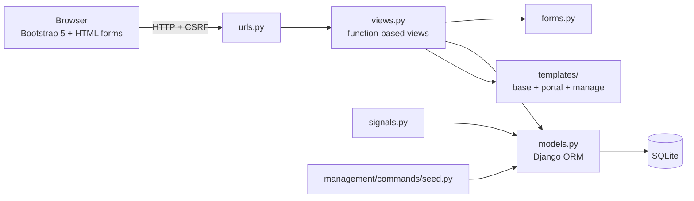
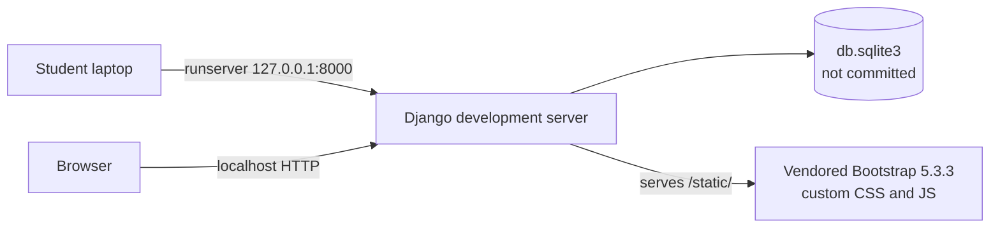
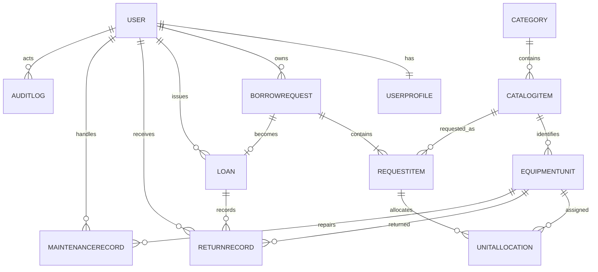

# 02 — System Design

## 1. Architecture

The project follows Django's MTV pattern. It is a single Django project with one
application; all administrative behaviour is custom-coded, and the built-in Django
admin is neither installed nor routed.



Deployment for the demonstration:



- **Model:** 11 application entities plus Django's `User`.
- **Template:** server-rendered HTML with a locally vendored Bootstrap 5.3.3, a layered
  custom stylesheet, shared partials, and a small progressive-enhancement script. The
  interface has no build step and no runtime CDN dependency.
- **View:** function-based views; workflows follow POST + redirect + messages.
- **Routing:** one project URLConf grouped by requirement area.
- **Configuration:** `SECRET_KEY`, `DEBUG`, and `ALLOWED_HOSTS` come from environment
  variables, with a documented development fallback. `.env` is git-ignored.

## 2. Data model



| Entity | Key fields | Relationships |
| :--- | :--- | :--- |
| `User` (Django Auth) | username, password hash, names, email, is_active | 1–1 `UserProfile` |
| `UserProfile` | role, contact_number, is_active | 1–1 `User` |
| `Category` | name, description, is_archived | 1–N `CatalogItem` |
| `CatalogItem` | name, description, is_archived | N–1 `Category`, 1–N `EquipmentUnit` |
| `EquipmentUnit` | asset_code (unique), condition, status, acquisition_date | N–1 `CatalogItem` |
| `BorrowRequest` | purpose, requested_at, return_date, status, admin_remarks | N–1 `User`, 1–N `RequestItem` |
| `RequestItem` | quantity | N–1 `BorrowRequest`, N–1 `CatalogItem` |
| `UnitAllocation` | allocated_at, released_at, release_reason | N–1 `RequestItem`, N–1 `EquipmentUnit` |
| `Loan` | issued_at | 1–1 `BorrowRequest`, N–1 issuing `User` |
| `ReturnRecord` | returned_at, condition_on_return | N–1 `Loan`, N–1 `EquipmentUnit`, N–1 receiving `User` |
| `MaintenanceRecord` | problem_description, action_taken, reported_at, fixed_at | N–1 `EquipmentUnit`, N–1 handling `User` |
| `AuditLog` | action, timestamp, details | N–1 acting `User` |
| `SystemSetting` | key (unique), value, description | — |

### Constraints that protect the inventory

| Constraint | Model | Why |
| :--- | :--- | :--- |
| `unique_catalog_item_per_request` | `RequestItem` | A request cannot list the same item twice |
| `request_item_quantity_gte_1` | `RequestItem` | Quantities are always positive |
| `unique_active_equipment_unit_allocation` (conditional on `released_at IS NULL`) | `UnitAllocation` | One physical unit has at most one active allocation while released history is retained |
| FK `PROTECT` on `RequestItem.catalog_item` | `RequestItem` | History survives catalog cleanup |
| FK `PROTECT` on `UnitAllocation.unit` | `UnitAllocation` | An allocated asset cannot disappear |
| `asset_code` unique | `EquipmentUnit` | Physical units are individually identifiable |
| One `Loan` per request | `Loan` | A request cannot be issued twice |

The ERD above corresponds to migrations `0001`, `0002`, and `0003`. Migration `0003`
introduces allocation history and replaces the unconditional allocation constraint.

## 3. Workflow design

```text
Pending ──approve──► Approved ──issue──► Issued ──partial return──► Partially Returned
   │                    │                    │                              │
   ├──reject──► Rejected│                    └────full return──► Returned ◄──┘
   └──cancel──► Cancelled ◄──cancel──┘
```

`Overdue` is computed from `BorrowRequest.return_date` and today's date. It is never
stored, so it cannot drift from the real dates.

### Concurrency strategy

1. `request_approve` opens `transaction.atomic()`.
2. The request and candidate units are loaded with `select_for_update()`.
3. Active allocations are excluded from the candidate set.
4. A unit is accepted only when its current status is `Available`.
5. `UnitAllocation` has a conditional database uniqueness constraint as the last line
   of defence.
6. Any failure rolls back both the reservation and the status change.

`issue_approved_request`, `record_unit_return`, `cancel_borrow_request`, and unit
retirement/restoration use the same lock-then-validate pattern.

## 4. Route map

```text
/                                  role_redirect
/dashboard/                        role_redirect (post-login target)

/manage/                           A7 dashboard
/manage/reports/equipment-usage.csv A7 loan/usage CSV
/manage/reports/overdue/           A7 overdue report
/manage/reports/overdue.csv        A7 overdue CSV
/manage/accounts/                  A1 account list
/manage/accounts/<id>/             A1 account history
/manage/categories/                A2 categories
/manage/catalog-items/             A2 catalog items
/manage/physical-units/            A2 + A6 units and reconciliation
/manage/requests/                  A3 review queue
/manage/releases/                  A4 release
/manage/returns/                   A5 returns and overdue list
/manage/maintenance/               A6 maintenance
/manage/audit-settings/            A8 audit and settings

/portal/                           U2 landing page
/portal/catalog/                   U2 browse/search
/portal/requests/new/              U3 submit
/portal/requests/                  U4 track/cancel
/portal/profile/                   U1 profile
/accounts/login/                   sign in
/accounts/register/                public basic-user registration
/accounts/logout/                  sign out
```

## 5. Key sequences

### Approve → release → return

1. Borrower submits a request → `Pending`; no unit changes state.
2. Admin approves → specific `Available` units become `Reserved` through
   `UnitAllocation`; the request becomes `Approved`.
3. Admin releases → units become `Issued`; a `Loan` is created; the request becomes
   `Issued`; a borrowing slip is available.
4. Admin records each return → a `ReturnRecord` is created, the allocation is marked
   released, and the unit becomes `Available` or `Maintenance`. The request becomes
   `Partially Returned` until every allocated unit is returned, then `Returned`.

### Cancellation

1. Borrower cancels a `Pending` or `Approved` request.
2. Reserved units are locked and validated.
3. Units return to `Available`; allocation rows are marked `released_at` with reason
   `Cancelled` instead of being deleted.
4. An audit entry records the released asset codes.

## 6. Template hierarchy

```text
base.html
├── registration/login.html
├── registration/register.html
├── portal/layout.html
│   ├── portal/catalog.html
│   ├── portal/request_form.html
│   ├── portal/request_history.html
│   └── portal/profile.html
└── manage/layout.html
    ├── manage/dashboard.html
    ├── manage/overdue_report.html
    ├── manage/accounts.html
    ├── manage/account_detail.html
    ├── manage/categories.html
    ├── manage/catalog_items.html
    ├── manage/physical_units.html
    ├── manage/request_review.html
    ├── manage/release_management.html
    ├── manage/borrowing_slip.html
    ├── manage/return_management.html
    ├── manage/maintenance_management.html
    └── manage/audit_settings.html
```

`manage/layout.html` is the single administrative shell. Shared building blocks live
in `templates/partials/` (flash messages, pagination, empty states, and the icon
sprite), and the `` template tag renders accessible inline SVG icons from
that sprite. Both role shells share `base.html`, which loads the local Bootstrap
build, the CSS layers in `static/css/` (base, layout, components, pages, responsive,
print), and a deferred `static/js/app.js`. The script is optional progressive
enhancement: mobile navigation, confirmation dialogs, toasts, password reveal, status
filters, and disclosure menus all degrade to working HTML without it.

## 7. Design decisions

| Decision | Reason | Trade-off |
| :--- | :--- | :--- |
| Function-based views | Easy to trace during a student defense | More repetition than generic views |
| Two role decorators | One obvious place to audit access control | Role check is not a mixin |
| Signal-created profiles | No user can exist without a role | Slightly implicit; documented in `signals.py` |
| Archive flags | Preserves request/loan history | More filtering in listings |
| Allocation history instead of deletion | Supports re-borrowing and a defensible audit trail | More rows and active-only filters |
| SQLite | Zero setup for the demo | Limited concurrent writes; fine at demo scale |
| Environment-based secrets | Keeps credentials out of source control | Requires `.env` setup for production-like runs |

## 8. Standards, legal, and ethical compliance

- **Privacy:** borrower identities and history are visible only to their owner and
  administrators; maintenance and audit pages are admin-only.
- **Data minimisation:** registration collects username, name, email, and contact
  number only. Seed data uses fictional identities.
- **Security:** Django authentication hashes passwords; CSRF middleware protects
  forms; ORM parameterisation prevents SQL injection; template escaping prevents XSS.
- **Accessibility:** semantic landmarks, tables, and labels; one `h1` per page with an
  ordered heading outline; visible focus styles; breadcrumb navigation; text statuses;
  skip link; keyboard-operable menus and dialogs; and responsive layouts. Styling is
  served locally and needs no network access.
- **Intellectual property:** the application uses Django and Bootstrap under their
  published licences; no copied proprietary code is included.
- **AI assistance:** used only as a development aid for review and documentation and
  declared according to the BulSU AI Policy; all submitted behaviour is testable.

## 9. Limitations and enhancements

Limitations:

- SQLite serialises writes; the locking code is written for a production database but
  is not load-tested.
- The interface is light-theme only and uses no client-side framework or build step.
- No email verification, password-reset delivery, or background notification service.
- Audit rows are append-only by convention, not by a database trigger.

Enhancements already delivered after review:

- Conditional active-allocation constraint and release timestamps.
- Live availability in the review queue.
- Date filters for requests, loans, and overdue reports.
- Dedicated overdue report and CSV.
- Account history page.
- Physical-unit filters by category, item, and status.
- Explicit serviceable-versus-available catalog counts.
- A unified "CampusFlow" interface with a responsive sidebar, card-based catalog and
  request history, accessible confirmation dialogs, toast feedback, and print styles.

## 10. Evidence

- `docs/evidence/check.txt` — Django system check.
- `docs/evidence/makemigrations_check.txt` — no missing migrations.
- `docs/evidence/tests.txt` — 123 passing tests and runtime.
- `docs/evidence/seed.txt` — final seeded dataset.
- `docs/evidence/environment.txt` — Python, Django, OS, CPU, and RAM used.
- `docs/evidence/accessibility.txt` — axe-core WCAG A/AA and automated layout audit
  across desktop and mobile viewports.
- `docs/evidence/screenshots/` — fourteen seeded screens covering the dashboard,
  review queue, accounts/history, physical units, release, returns, maintenance,
  audit/settings, overdue report, and the basic-user catalog/request/profile pages.
